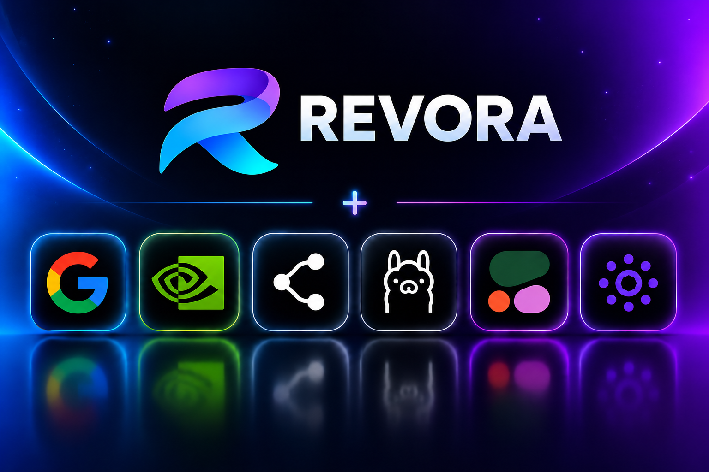
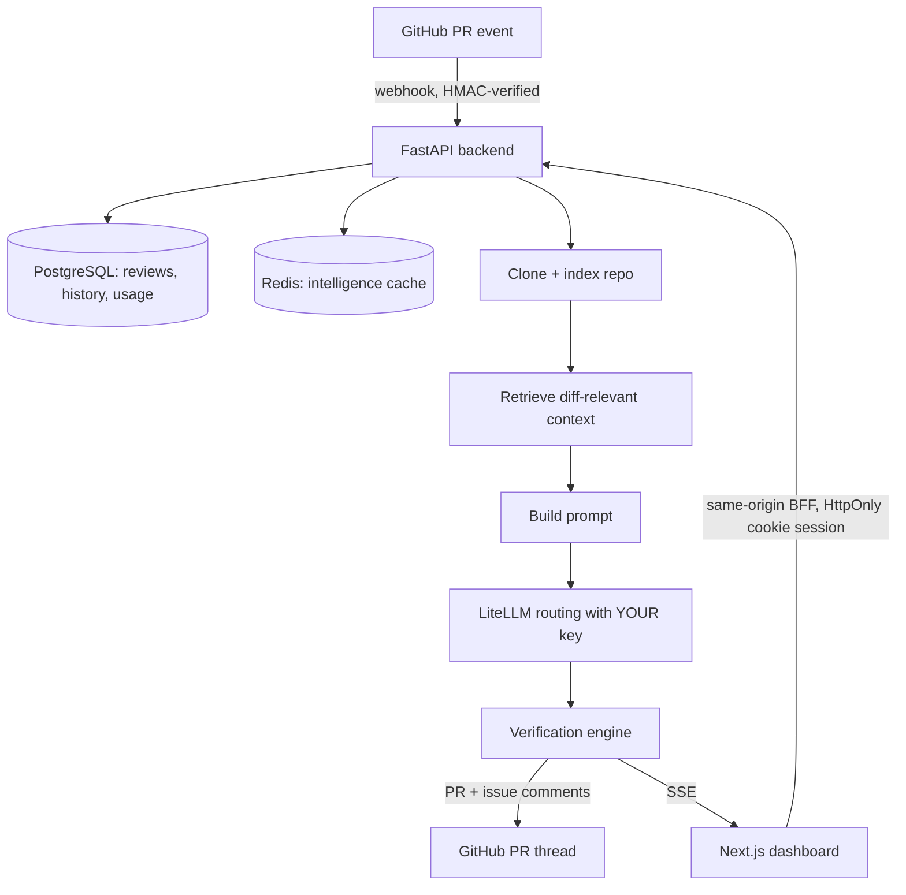

# Revora

**Self-hosted AI code review that indexes your whole repo before commenting on the PR.**

Status: under active development · MIT licensed · Latest tag: `v1.2.0` · Bring your own keys — no vendor lock-in.

[](LICENSE)
[](https://python.org)
[](https://nodejs.org)
[](docker-compose.yml)



Revora is an open-source, self-hosted AI code review platform. On every pull request, it clones the repo, builds a whole-repository index (17 detectors, 8 code-graph modules), retrieves the files that matter for the diff, and asks your chosen LLM for findings — then a verification engine re-checks each finding against the code and marks the survivors with a **Machine Verified** badge, right in the PR thread.

[Quick start](#quick-start) · [GitHub App setup](#github-app-setup) · [Providers](#supported-ai-providers) · [Docs](docs/)

## Is Revora for you?

**Use Revora if** you want review comments grounded in your actual codebase, you want to self-host, and you're happy to bring at least one LLM API key and run Docker Compose.

**Don't use Revora if** you want a zero-setup hosted bot, you can't install a GitHub App on your repos, or you need a stable API — the project is pre-release and breaking changes land on feature branches.

## Quick start

Prerequisites: **Python 3.11+**, **Node.js 20+**, **Docker & Docker Compose**, a **GitHub App** ([setup](#github-app-setup), ~10 min), and **one LLM API key**.

```bash
git clone https://github.com/d-kavinraja/revora.git
cd revora

# 1. Backend secrets (fill in backend/.env — see Configuration)
cp backend/.env.example backend/.env

# 2. Frontend config
cp frontend/.env.example frontend/.env.local

# 3. Database password for Compose (shell or root .env file)
export POSTGRES_PASSWORD="pick-a-strong-password"   # PowerShell: $env:POSTGRES_PASSWORD="..."

# 4. Start everything
docker-compose up --build
```

Then open the UI at `http://localhost:3000`, sign in with GitHub, install the app on a repo, and open a pull request — the first review lands as PR comments plus live progress in the dashboard. API docs (auto-generated) live at `http://localhost:8000/docs`.

> Local dev without Docker is possible (uvicorn + `npm run dev` against local Postgres 15 and Redis 7) but undocumented here — Compose is the supported path. `docker-compose.prod.yml` covers pinned-image production deploys.

## GitHub App setup

Revora is GitHub-native: PR events arrive at `POST /api/v1/webhooks/github` (HMAC-verified), and login uses the app's OAuth credentials with a `http://localhost:3000/auth/callback` redirect.

1. GitHub → Settings → Developer settings → **New GitHub App**. Note the **App ID**, **Client ID**, **Client secret**, generate a **private key**, and set a **webhook secret**.
2. Permissions: **Contents — Read-only** (clone for indexing), **Pull requests — Read & write** (review + issue comments).
3. Subscribe to events: **Pull request** (opened, synchronize, reopened, closed) and **Installation** / **Installation repositories**.
4. Webhook URL: `https://<your-host>/api/v1/webhooks/github` (for local trials, expose port 8000 via a tunnel; localhost can't receive GitHub webhooks). OAuth callback URL: `http://localhost:3000/auth/callback`.
5. Install the app on the repos to review.
6. Copy the credentials into `backend/.env` (`GITHUB_APP_ID`, `GITHUB_APP_PRIVATE_KEY`, `GITHUB_WEBHOOK_SECRET`, `GITHUB_CLIENT_ID`, `GITHUB_CLIENT_SECRET`) and the Client ID into `frontend/.env.local` (`NEXT_PUBLIC_GITHUB_CLIENT_ID`), then restart Compose.

## Configuration

Backend (`backend/.env` — never committed):

| Variable | Required | Purpose |
|---|---|---|
| `DATABASE_URL` | For local runs | SQLAlchemy URL; under Compose this is overridden to the `db` service |
| `POSTGRES_PASSWORD` | For Compose | Shell/root `.env`; must match `DATABASE_URL` credentials |
| `SECRET_KEY`, `JWT_SECRET_KEY`, `ENCRYPTION_KEY` | Yes | Sessions, JWTs, and Fernet encryption of stored provider keys |
| `GITHUB_CLIENT_ID`, `GITHUB_CLIENT_SECRET` | Yes | GitHub login (OAuth) |
| `GITHUB_APP_ID`, `GITHUB_APP_PRIVATE_KEY`, `GITHUB_WEBHOOK_SECRET` | Yes | Repo access, clone auth, webhook verification |
| `GEMINI_API_KEY` (or another provider key) | At least one | Review inference via your own key |
| `MOUTHMAP_HF_ENDPOINT_URL`, `MOUTHMAP_HF_API_TOKEN` | For Model Lab | Private inference Space URL + token (server-side only) |

Frontend (`frontend/.env.local`):

| Variable | Purpose |
|---|---|
| `NEXT_PUBLIC_API_URL` | Backend base URL (`http://localhost:8000/api/v1` locally) |
| `NEXT_PUBLIC_GITHUB_CLIENT_ID` | Same Client ID as the backend setting |

## Features

- **Repository-aware reviews** — full-repo index per PR: 17 detectors plus import/call/module/dependency/API/config/DB/test code graphs; retrieval feeds the diff-relevant files into the prompt.
- **Verified findings** — the verification engine re-checks AI output against the codebase, scores confidence deterministically, and badges solid findings **Machine Verified** in the review UI.
- **Bring your own key** — every review executes strictly under the API key and model you configured per provider; keys are encrypted at rest and never leave the server.
- **Multi-provider routing** — LiteLLM-powered routing across the providers below; Groq is a first-class provider.
- **Live progress** — review stages stream to the dashboard over Server-Sent Events; history, cost, and token usage persist in PostgreSQL.
- **Model Lab** — an experimental workbench (see `/model-lab`) including MouthMap lip-reading inference, served by a private Hugging Face Space and gated behind the `MOUTHMAP_*` settings above.


## Architecture



Reviews run as in-process background tasks behind a per-route concurrency gate — there is no separate worker service in `docker-compose.yml`.

## Supported AI providers

Providers are configured in-app with your own keys and routed through LiteLLM — no Revora-hosted keys, no fallback to anyone else's quota. Verified working: **Groq** (first-class), **Gemini**, **OpenAI**, **Anthropic**, **Cohere**, **Mistral**, **DeepSeek**, **xAI/Grok**, **Azure OpenAI**, **NVIDIA NIM**, **Ollama Cloud**, **OpenRouter**. Any other LiteLLM-supported provider works the same way; the in-app Providers page is the source of truth for what your deployment offers.

## Repository map

```
revora/
├── backend/            # FastAPI service (requires-python >=3.11)
│   ├── app/
│   │   ├── ai/         # Model registry + LiteLLM wrapper
│   │   ├── api/        # Route tables incl. webhooks, auth, mouthmap
│   │   ├── indexing/   # 8 code-graph builders + Tree-Sitter module (stubbed)
│   │   ├── intelligence/ # 17 detectors: framework, metrics, compat…
│   │   ├── mouthmap/   # HF Space client (streaming, capped, gated)
│   │   ├── pipeline/ retrieval/ verification/  # Review orchestration
│   │   ├── github/ middleware/ security/ sse/ # Webhooks, guards, streaming
│   │   └── core/ db/ models/ schemas/ services/
│   ├── alembic/        # Migrations (run `alembic upgrade head` in prod)
│   ├── tests/          # pytest suite (`asyncio-mode=auto`, sqlite)
│   └── Dockerfile
├── frontend/           # Next.js 16 app (Node >=20.9)
│   ├── src/app/        # Routes incl. (dashboard)/model-lab, auth/callback
│   ├── src/components/ src/lib/ src/store/
│   └── Dockerfile
├── docs/               # Deep dives (linked below, not required reading)
├── docker-compose.yml  # Dev stack: db, redis, backend, frontend
└── docker-compose.prod.yml  # Pinned images, no reload
```

Indexing today is regex-based; the Tree-Sitter indexer module exists but populates placeholder graphs — semantic parsing is still in development.

## Documentation

Deep dives live in [`docs/`](docs/): [context retrieval](docs/context-retrieval.md) · [ranking](docs/ranking.md) · [token budget](docs/token-budget.md) · [compression](docs/compression.md) · [cache strategy](docs/cache-strategy.md) · [prompt builder](docs/prompt_builder_engine_plan.md) · [BYOK orchestration](docs/byok-orchestrator-plan.md) · [Groq provider](docs/groq-provider.md) · [MouthMap](docs/mouthmap.md). Per-package notes: [frontend](frontend/README.md).

## Contributing & security

Bug reports and PRs welcome — please read [CONTRIBUTING.md](CONTRIBUTING.md) first (conventional commits, pytest + `tsc --noEmit` green before pushing). For vulnerabilities, **do not open a public issue** — see [SECURITY.md](SECURITY.md).

## Status & licence

Under active development; expect breaking changes on feature branches. Latest tag: `v1.2.0` — see [releases](https://github.com/d-kavinraja/revora/releases) and commit history for what's landing. MIT licensed — see [LICENSE](LICENSE).
