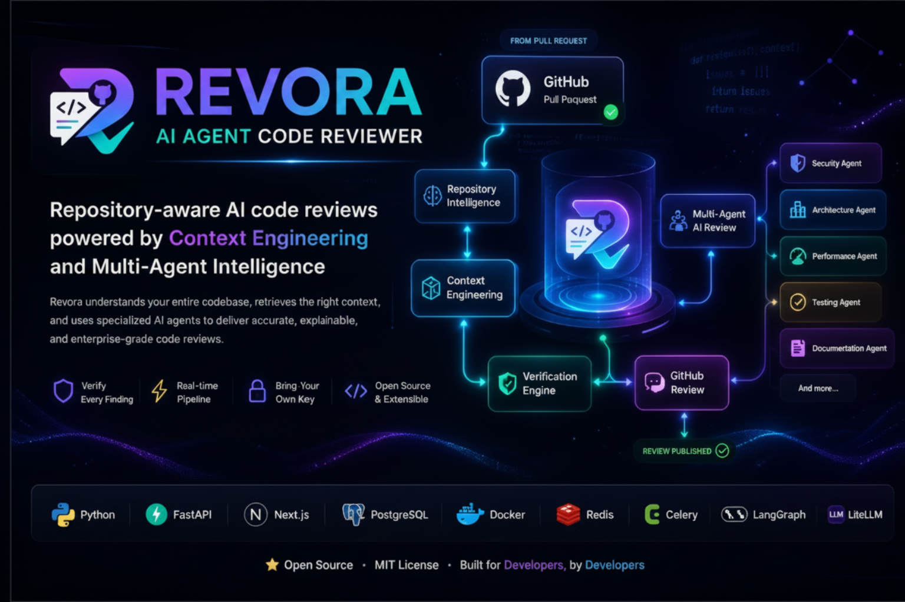
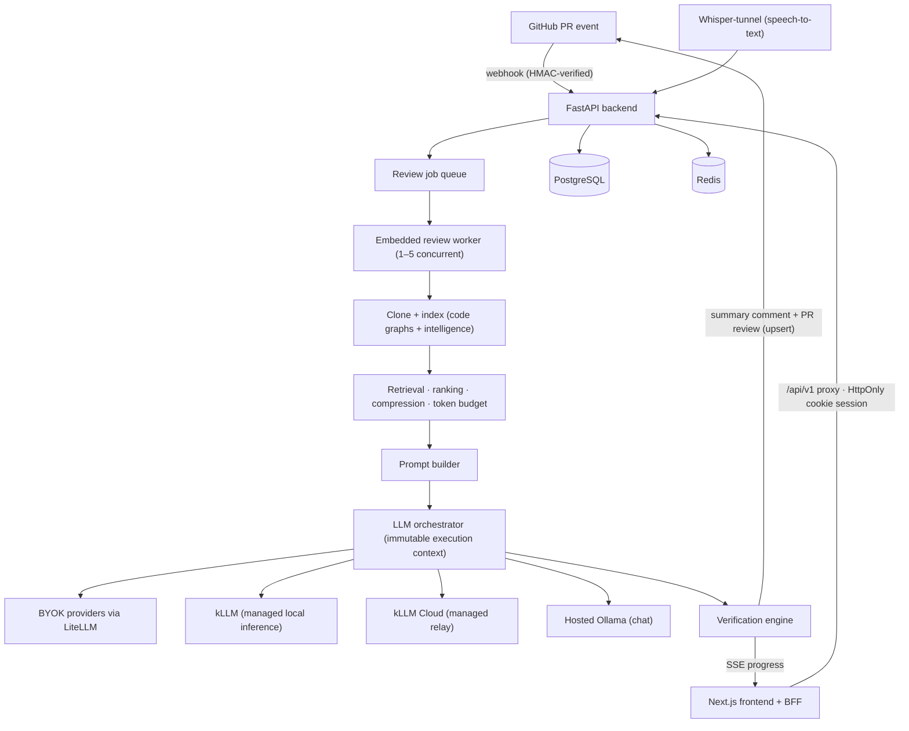
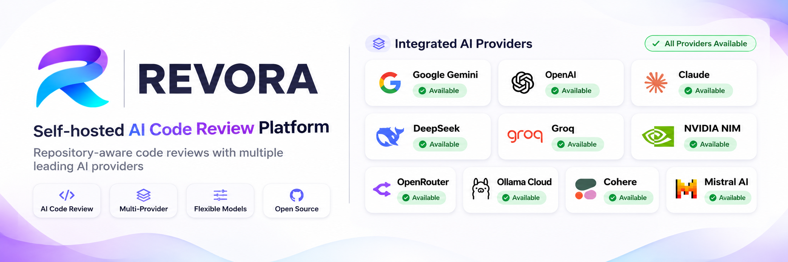

<div align="center">
  

  <h1>Revora</h1>

  <p><strong>Self-hosted AI code review that indexes your whole repo before commenting on your PR.</strong></p>

  <p>Revora clones the repository, builds a whole-repo index, retrieves the context that matters
  for the diff, and asks <em>your</em> chosen LLM for findings — then a verification engine re-checks
  every finding against the code before anything is published to GitHub.</p>

  <p>
    <a href="https://github.com/d-kavinraja/revora/blob/main/LICENSE"></a>
    
    
    <a href="https://github.com/d-kavinraja/revora/releases"></a>
    
    
  </p>

  <p>
    <a href="#quick-start">Quick start</a> ·
    <a href="#github-app-setup">GitHub App setup</a> ·
    <a href="#ai-providers--models">AI providers</a> ·
    <a href="#architecture">Architecture</a> ·
    <a href="docs/">Docs</a>
  </p>
</div>



## Contents

- [About](#about)
- [Features](#features)
- [Architecture](#architecture)
- [Technology stack](#technology-stack)
- [Quick start](#quick-start)
- [GitHub App setup](#github-app-setup)
- [Configuration](#configuration)
- [AI providers & models](#ai-providers--models)
- [Chat](#chat)
- [Review lifecycle & history](#review-lifecycle--history)
- [Platform administration](#platform-administration)
- [Deployment](#deployment)
- [Development](#development)
- [Security & privacy](#security--privacy)
- [Project status](#project-status)

## About

Most AI review bots see only the diff. Revora is built around the idea that useful review
comments need **repository context**: on every pull request it clones the repo, builds an index
(import, call, module, dependency, API, config, DB and test code graphs), retrieves the
diff-relevant files, compresses them into a budgeted prompt, and only then calls the LLM.
A verification pass re-checks the model's findings against the actual code before anything is
posted, so the review that lands in your PR thread is grounded, ranked, and de-duplicated.

Revora is **self-hosted** and **bring-your-own-key**: you run the stack (Docker Compose), you
own the data (PostgreSQL), and every review executes strictly under the provider, model and API
key you configured — there is no Revora-hosted quota and no silent model switching.

> [!NOTE]
> Revora also ships an AI chat workspace (temporary & persistent chat), managed local inference
> (kLLM), an optional Revora-managed relay (kLLM Cloud), and a full admin console — all described below.

## Features

### 🧠 Repository-aware code reviews

- **Whole-repo indexing per PR** — 8 code graphs (import, call, module, dependency, API, config, DB, test) plus repo-intelligence analysis (language, framework, architecture, database, dependencies, testing, build, CI/CD, security, cloud, queues, secrets, complexity, duplication, dead code, metrics).
- **Context engineering pipeline** — retrieval with a fallback chain (graph traversal → knowledge base → static analysis → diff-only → graceful degradation), multi-factor ranking, staged compression (dedup → import pruning → symbol merge → truncation → summarization), and token-budget presets from 4k to 128k.
- **Verified findings** — the verification engine re-checks AI output against the codebase, removes hallucinations, de-duplicates, and ranks severity before publishing.
- **Clean PR threads** — a single top-level Revora summary comment per PR is created once and *edited* on reruns (never duplicated); inline findings are posted as PR review comments with a clear event signal (`APPROVE` / `REQUEST_CHANGES` / `COMMENT`).
- **Immutable execution context** — provider, model and API key are resolved once before the review starts and never switch mid-run. Explicit repository mappings are fail-fast; routed reviews allow transient-only retries. Repositories can opt into ranked fallback routes (`fallback_enabled`), which affect execution only — never the saved mapping.
- **Live progress** — review stages stream to the dashboard over Server-Sent Events; every execution is snapshotted with its context, tokens, cost and timeline.

### 💬 AI chat

- **Temporary Chat** — fully in-memory: prompts, responses and metadata are never persisted.
- **Persistent Chat** — stored, owner-scoped conversations with rename, edit, regenerate, revisions and per-conversation history (500 messages per conversation, 100 conversations per user, 20 MB stored text per user).
- Streaming responses with context trimming against the selected model's window, per-provider status banners, and a model picker.
- Optional **speech-to-text** composer backed by a private Whisper-tiny service (off by default; no audio or transcripts are stored).

### 🔌 Providers & models

- **Bring your own key** across Gemini, OpenAI, Claude, DeepSeek, Groq, NVIDIA NIM, OpenRouter, Cohere, Mistral, xAI/Grok and Ollama Cloud via LiteLLM routing.
- **Managed inference**: kLLM (server-owned local inference with model readiness/autoload lifecycle), kLLM Cloud (optional Revora-managed relay with deny-by-default model approval) and Hosted Ollama (chat-only remote models).
- **Model administration** — per-provider model discovery/sync, availability overrides, per-repository review mappings, user routing preferences, API-key CRUD with rotate/enable/disable/health, and per-feature route recommendations.

### 🛠 Platform

- **Review lifecycle** — cancel running reviews; rerun, retry or restart completed ones; inspect per-review history and stage timelines.
- **Admin console** (`/admin`) — users, repositories, reviews, providers, keys, models, kLLM, kLLM Cloud, hosted models, speech, chat modes, installations, maintenance, usage analytics, announcements and an audit log.
- **Feature flags** — live toggles for Chat, Reviews, Model Lab, usage/analytics, guide and more; flips apply immediately with no redeploy and never delete stored data.
- **Authentication** — GitHub OAuth with single-use login-CSRF state relayed through a same-origin BFF, HttpOnly cookie sessions, local registration/login, and rate limiting on sensitive endpoints.

### 🔬 Model Lab *(experimental)*

An inference-only workbench behind feature flags, backed by private Hugging Face Spaces — the
React app never calls Hugging Face directly and never sees a Space token:

- **MouthMap** — lip-reading video inference with a seeded test dataset and run history.
- **BotaniQ** — medicinal-plant identification from leaf/plant images with top-5 results and history.


## Architecture



### Review pipeline

```mermaid
graph LR
    A["Webhook / manual run"] --> B["Clone & index"]
    B --> C["Repo intelligence"]
    C --> D["Context retrieval"]
    D --> E["Ranking"]
    E --> F["Compression"]
    F --> G["Token budget"]
    G --> H["Prompt build"]
    H --> I["LLM call (BYOK / managed)"]
    I --> J["Verification"]
    J --> K["Publish to GitHub"]
    K --> L["Snapshot + SSE"]
```



Each stage degrades gracefully: a failure in one stage narrows the context instead of failing the
review, and publish errors never swallow a generated summary. Reviews run inside the backend
process behind a bounded concurrency gate (`REVIEW_WORKER_CONCURRENCY`, default 1, max 5) with
atomic job claiming, so multiple backend processes are safe.

## Technology stack

| Layer | Technology |
|---|---|
| Backend | Python 3.11+ · FastAPI · SQLAlchemy (async) · Alembic · Pydantic |
| Frontend | Next.js (React) · TypeScript · Tailwind CSS · Zustand |
| AI | LiteLLM routing · kLLM local inference · kLLM Cloud relay · hosted Ollama |
| Data | PostgreSQL 15 · Redis 7 (caching, intelligence cache) |
| Integrations | GitHub App (webhooks, OAuth, PR reviews) · Hugging Face Spaces (Model Lab) |
| Ops | Docker Compose (dev + prod) · PgBouncer (prod) · health checks on `/readyz` |

## Quick start

**Prerequisites:** Python 3.11+ · Node.js 20+ · Docker & Docker Compose · a [GitHub App](#github-app-setup) (~10 min) · at least one LLM API key.

```bash
git clone https://github.com/d-kavinraja/revora.git
cd revora

# 1. Backend secrets (see Configuration)
cp backend/.env.example backend/.env

# 2. Frontend config
cp frontend/.env.example frontend/.env.local

# 3. Database password for Compose (shell or root .env file)
export POSTGRES_PASSWORD="pick-a-strong-password"   # PowerShell: $env:POSTGRES_PASSWORD="..."

# 4. Start everything
docker-compose up --build
```

Then open `http://localhost:3000`, sign in with GitHub, install the app on a repository, and open
a pull request — the first review lands as PR comments plus live progress in the dashboard.
Auto-generated API docs live at `http://localhost:8000/docs`.

**Windows:** `run.bat` starts the stack without Docker — the managed Whisper-tunnel supervisor
(`scripts/dev-whisper-tunnel.ps1`), migrations + backend on port 8000 (`scripts/dev-backend.ps1`),
and the Next.js dev server on port 3000, each in its own terminal. `run.command` is the macOS
counterpart. Voice input fails closed if the tunnel is not running.

> [!TIP]
> Local dev against your own PostgreSQL 15 + Redis 7 works too (uvicorn + `npm run dev`);
> Compose is the supported path. `docker-compose.prod.yml` covers production deploys.

## GitHub App setup

Revora is GitHub-native: PR events arrive at `POST /api/v1/webhooks/github` (HMAC-verified) and
login uses the app's OAuth credentials.

1. GitHub → **Settings → Developer settings → New GitHub App**. Note the **App ID**, **Client ID**, **Client secret**, generate a **private key**, and set a **webhook secret**.
2. Permissions: **Contents — Read-only** (clone for indexing) and **Pull requests — Read & write** (reviews + comments).
3. Subscribe to events: **Pull request** (opened, synchronize, reopened, closed) and **Installation** / **Installation repositories**.
4. Webhook URL: `https://<your-host>/api/v1/webhooks/github` (for local trials, expose port 8000 via a tunnel — localhost cannot receive GitHub webhooks). OAuth callback URL: `http://localhost:3000/auth/callback`.
5. Install the app on the repositories you want reviewed.
6. Copy the credentials into `backend/.env` (`GITHUB_APP_ID`, `GITHUB_APP_PRIVATE_KEY`, `GITHUB_WEBHOOK_SECRET`, `GITHUB_CLIENT_ID`, `GITHUB_CLIENT_SECRET`) and the Client ID into `frontend/.env.local` (`NEXT_PUBLIC_GITHUB_CLIENT_ID`), then restart.

## Configuration

### Backend — `backend/.env` (never committed)

| Variable | Required | Purpose |
|---|---|---|
| `DATABASE_URL` | Local runs | SQLAlchemy URL; under Compose this is overridden to the `db` service |
| `POSTGRES_PASSWORD` | Compose | Shell/root `.env`; must match `DATABASE_URL` credentials |
| `SECRET_KEY`, `JWT_SECRET_KEY`, `ENCRYPTION_KEY` | Yes | Sessions, JWTs, and Fernet encryption of stored provider keys |
| `GITHUB_CLIENT_ID`, `GITHUB_CLIENT_SECRET` | Yes | GitHub OAuth login |
| `GITHUB_APP_ID`, `GITHUB_APP_PRIVATE_KEY`, `GITHUB_WEBHOOK_SECRET` | Yes | Repo access, clone auth, webhook signature verification |
| `GEMINI_API_KEY` (or another provider key) | At least one | Review/chat inference with your own key |
| `CORS_ORIGINS` | Production | Explicit frontend origins (localhost ports are allowed automatically in development) |

Optional, off by default — enable only what you use:

| Area | Variables | Notes |
|---|---|---|
| Model Lab: MouthMap | `MOUTHMAP_HF_ENDPOINT_URL`, `MOUTHMAP_HF_API_TOKEN`, `MOUTHMAP_MAX_UPLOAD_MB`, … | Private HF Space; token is server-side only |
| kLLM (managed local) | `KLLM_ENABLED`, `KLLM_SERVER_URL`, `KLLM_GATEWAY_API_KEY` | Needs the flag **and** an admin enabling the seeded `kllm` provider |
| kLLM Cloud (managed relay) | `KLLM_CLOUD_ENABLED`, `KLLM_CLOUD_BASE_URL`, `KLLM_CLOUD_API_KEY`, cost/timeout tuning | HTTPS-only base URL; models are administrator-approved, deny-by-default |
| Hosted Ollama | `REVORA_HOSTED_OLLAMA_ENABLED`, `REVORA_HOSTED_OLLAMA_BASE_URL`, `REVORA_HOSTED_OLLAMA_TOKEN`, … | Chat-only; only runtime-loaded models are exposed |
| Speech-to-text | `REVORA_SPEECH_ENABLED`, `REVORA_SPEECH_BASE_URL`, `REVORA_SPEECH_TOKEN` | Private Whisper-tiny behind the tunnel; fails closed when off |

`backend/.env.example` is the source of truth for the full list (timeouts, concurrency, rate limits).

### Frontend — `frontend/.env.local`

| Variable | Purpose |
|---|---|
| `NEXT_PUBLIC_API_URL` | Backend base URL (`http://localhost:8000/api/v1` locally) |
| `NEXT_PUBLIC_USE_API_PROXY` / `BACKEND_ORIGIN` | Same-origin proxy mode for production (browser always calls `/api/v1`; `BACKEND_ORIGIN` is server-only) |
| `NEXT_PUBLIC_GITHUB_CLIENT_ID` | Same OAuth Client ID as the backend setting |
| `NEXT_PUBLIC_SITE_URL` | Public origin for canonical URLs / sitemap |

## AI providers & models



### Bring your own key

Providers are configured in-app with your own API keys and routed through LiteLLM. Verified
working: **Gemini**, **OpenAI**, **Claude (Anthropic)**, **DeepSeek**, **Groq** (first-class),
**NVIDIA NIM**, **OpenRouter**, **Cohere**, **Mistral**, **xAI/Grok**, **Ollama Cloud**. Any other
LiteLLM-supported provider works the same way; the in-app Providers page is the source of truth
for what your deployment offers. Keys are encrypted at rest, can be rotated, enabled/disabled,
and have per-key health checks.

### Managed providers

| Provider | Scope | Enablement | Notes |
|---|---|---|---|
| **kLLM** | Reviews + Chat | `KLLM_ENABLED` **and** admin enables the seeded provider | Server-owned local inference (loopback needs no gateway key); model readiness/autoload lifecycle, telemetry and activity views |
| **kLLM Cloud** | Reviews + Chat (per approved model) | `KLLM_CLOUD_ENABLED`, admin enables provider **and** approves each model | Revora-managed relay; only `/v1/models`, `/health`, `/v1/chat/completions` are used; Chat and Review eligibility are independent, per-model flags |
| **Hosted Ollama** | Chat only | `REVORA_HOSTED_OLLAMA_ENABLED` + admin "Hosted models" toggle | Only models already loaded in the remote runtime are listed — Revora never auto-loads a model just to show it |

### Routing & execution semantics

- **MODE 1 — explicit repository mapping:** provider/model/key pinned per repository; fail-fast, zero fallback.
- **MODE 2 — user routing preferences:** single resolved provider with transient-only retries.
- **MODE 3 — nothing configured:** the review stops with an actionable error. It never executes with a model you did not resolve.
- Optional **repository fallback** (`fallback_enabled`) tries up to two ranked alternatives from the router, one attempt each; the saved mapping is never rewritten.
- Managed models are **approved by administrators (deny-by-default)** and can be overridden to *disabled* per model; revoking approval removes them from future routing immediately.

> [!IMPORTANT]
> **Data flow:** review and chat content is sent to whichever provider executes the request —
> your own provider account (BYOK), your own kLLM host, or the kLLM Cloud relay / hosted Ollama
> when you explicitly enable them. Revora does not claim zero retention or encryption beyond
> what each upstream provider documents; check your provider's policy before enabling it.

## Chat

| | Temporary Chat | Persistent Chat |
|---|---|---|
| Storage | In-memory only — nothing persisted | Stored per user in PostgreSQL |
| History | Session only | Conversations with rename, edit, regenerate, revisions |
| Limits | Context trimmed to the model window | 500 messages/conversation · 100 conversations/user · 20 MB text/user |
| Availability | Feature flag `chat` | Feature flag `chat` + admin chat-mode toggle (can be read-only) |
| Providers | kLLM, kLLM Cloud, hosted Ollama, BYOK | Same |

## Review lifecycle & history

- **Review history** with per-review detail: findings, verification results, provider/model used, token usage and cost.
- **Execution snapshots** — each run records its immutable execution context (provider, model, key source) and stage-by-stage timeline.
- **Actions** — cancel a running review; **rerun** / **retry** / **restart** a past one. Every action creates a new review record with a fresh execution context; existing reviews remain immutable.
- **PR hygiene** — reruns edit the existing summary comment and PR review in place, so a PR never accumulates duplicate Revora comments.

## Platform administration

The admin console at `/admin` (separate admin sign-in) manages:

- **Users & installations** — accounts (including disable/enable), GitHub installations.
- **Repositories & reviews** — sync runs, per-repo review configuration, review oversight.
- **Providers, keys & models** — provider registry (enable/disable, model sync), key management, model approvals and availability overrides.
- **kLLM / kLLM Cloud / hosted models / speech** — lifecycle, readiness and per-surface gating of managed inference.
- **Feature flags** — canonical flags (`chat`, `reviews`, `review_initiation`, `model_lab`, `mouthmap`, `botaniq`, `api_keys_add`, `routing_mapping`, `usage`, `analytics`, `guide`, `kllm_page`, `kllm_cloud_page`) with live status/messages; a missing flag row means *enabled*.
- **Operations** — maintenance mode (admin routes stay operable), announcements (draft/published, scheduled), usage analytics, and an audit log of admin actions.

## Deployment

Two Compose files ship in the repo:

| File | Use | Characteristics |
|---|---|---|
| `docker-compose.yml` | Development | `db`, `redis`, `whisper-tunnel`, `backend`, `frontend`; source bind mounts, exposed DB/Redis ports |
| `docker-compose.prod.yml` | Production | Pinned images, no reload/bind mounts, PgBouncer in front of Postgres, no exposed DB/Redis ports, resource limits, health checks on `/readyz` |

Key deployment facts (both verified in the compose/Docker files):

- **Migrations run on start** — the backend container runs `alembic upgrade head` before serving.
- **Services:** PostgreSQL 15, Redis 7, backend (FastAPI, non-root user, embedded review worker), frontend (Next.js production build). PgBouncer and the whisper tunnel are prod-stack extras.
- **Health checks** gate dependent services (`pg_isready`, `redis-cli ping`, `curl /readyz`).
- **Frontend networking:** the browser calls same-origin `/api/v1`; the Next.js server reaches the backend over the Docker network — internal hostnames are never exposed to the browser.
- **Resource limits** are set per service (512 MB–1 GB) and `start.sh` is tuned for small hosts.

**Verification after deploy:** open `http://<host>:3000`, sign in with GitHub, confirm `/readyz` returns 200, install the GitHub App on a test repo and open a PR. Common issues: webhook URL not reachable from GitHub (use a tunnel for local trials), `GITHUB_WEBHOOK_SECRET` mismatch, missing `ENCRYPTION_KEY`/`JWT_SECRET_KEY` in production, or `CORS_ORIGINS` not listing the frontend origin.

## Development

```
revora/
├── backend/              # FastAPI service (requires-python >=3.11)
│   ├── app/
│   │   ├── ai/           # LiteLLM wrapper + model registry + discovery
│   │   ├── api/v1/       # REST surface incl. webhooks, auth, chat, admin namespace
│   │   ├── pipeline/     # Review orchestration (stages, publish, upsert)
│   │   ├── retrieval/    # retrieval · ranking · compression · token budgets
│   │   ├── verification/ # finding verification engine
│   │   ├── indexing/     # code-graph builders (+ Tree-Sitter module, in development)
│   │   ├── intelligence/ # repo-intelligence detectors & engines
│   │   ├── orchestrator/ # immutable execution context + LLM orchestration
│   │   ├── queue/        # review job queue + embedded worker
│   │   ├── services/     # routing, keys, platform settings, managed providers…
│   │   └── github/ github_review/ prompt_engine/ knowledge/ sse/ security/ …
│   ├── alembic/          # migrations (run automatically on container start)
│   └── tests/            # pytest (SQLite, asyncio-mode=auto)
├── frontend/             # Next.js app (Node 20+)
│   └── src/app/          # (home), (auth), (dashboard), admin console, auth/callback
├── docs/                 # deep dives (linked below)
├── tests/e2e/            # end-to-end scenario tests
├── scripts/              # dev helpers (backend, whisper tunnel)
└── docker-compose[.prod].yml
```

**Workflow** (see [CONTRIBUTING.md](CONTRIBUTING.md) for the full conventions):

- Backend: `pytest` green before pushing.
- Frontend: `tsc --noEmit` clean, `eslint` clean on touched files, `next build` succeeds; unit tests run with `npm test` (node's test runner).
- Conventional Commits; keep PRs scoped.

**Docs deep dives:** [context retrieval](docs/context-retrieval.md) · [ranking](docs/ranking.md) · [token budget](docs/token-budget.md) · [compression](docs/compression.md) · [cache strategy](docs/cache-strategy.md) · [prompt builder](docs/prompt_builder_engine_plan.md) · [BYOK orchestration](docs/byok-orchestrator-plan.md) · [kLLM Cloud review routing](docs/kllm-cloud-review-routing.md) · [Groq provider](docs/groq-provider.md) · [MouthMap](docs/mouthmap.md) · [frontend notes](frontend/README.md)

## Security & privacy

- **Credential handling** — provider API keys are encrypted at rest (Fernet, `ENCRYPTION_KEY`) and never returned by any API; managed-service URLs/tokens (`KLLM_*`, `REVORA_*`, `MOUTHMAP_*`) stay server-side.
- **Webhook authenticity** — every GitHub webhook is HMAC-verified against `GITHUB_WEBHOOK_SECRET` (mandatory in non-development environments).
- **Auth** — GitHub OAuth uses a single-use login-CSRF state minted through the same-origin BFF; sessions are HttpOnly cookies; sensitive endpoints are rate-limited.
- **Least privilege** — containers run as non-root with dropped capabilities (whisper tunnel is read-only with `no-new-privileges`); the whisper tunnel publishes no host port.
- **AI data flow** — review/chat content goes to the provider that executes the request (your BYOK provider, your kLLM host, or an enabled managed relay). No blanket privacy or zero-retention claims are made on behalf of upstream providers.
- **Reporting** — please use [private vulnerability reporting](SECURITY.md); do not open public issues for security-sensitive findings.

## Project status

Revora is under active development — expect breaking changes on feature branches. Honest notes on
what is complete today versus emerging:

| Area | Status |
|---|---|
| Review pipeline, verification, PR publishing, lifecycle | ✅ Implemented |
| Chat (temporary + persistent), BYOK providers, admin console | ✅ Implemented |
| kLLM & Hosted Ollama managed inference | ✅ Implemented (disabled by default) |
| kLLM Cloud relay | 🧪 Implemented behind flags; automatic Review routing behavior is documented in [docs/kllm-cloud-review-routing.md](docs/kllm-cloud-review-routing.md) pending a product decision |
| Model Lab (MouthMap, BotaniQ) | 🔬 Experimental, feature-flag gated |
| Tree-Sitter semantic indexing | 🚧 In development (current indexing is regex-based; the module ships with placeholder graphs) |

---

<p align="center">
  <a href="CONTRIBUTING.md">Contributing</a> ·
  <a href="SECURITY.md">Security policy</a> ·
  <a href="LICENSE">MIT License</a>
</p>
